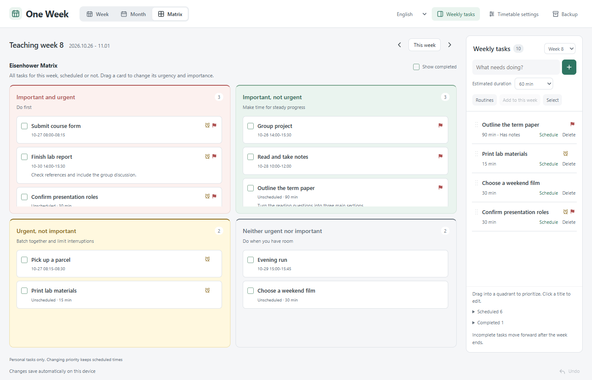

# One Week

Plan your week around your class timetable.

One Week is a local-first planner for students using Obsidian. Put your recurring classes on a teaching-week timetable, capture what you want to do, then drag tasks into your free time. A weekly calendar, monthly overview, and Eisenhower matrix share the same tasks.

[简体中文](README.zh-CN.md) · [Download](https://github.com/yibai435-star/one-week/releases) · [Report an issue](https://github.com/yibai435-star/one-week/issues)


## Make room for your week

- **Teaching-week timetable.** Set the semester's first Monday and week count. Classes support custom clock times, selected weeks, and odd/even week patterns.
- **Tasks beside your timetable.** Capture tasks without assigning a time. Drag them into a free slot, use the Schedule button, or return them to the task list.
- **Week, month, and matrix.** Edit the same title, notes, priority, time, and completion state from every view. Classes stay separate from the Eisenhower matrix.
- **One-off class changes.** Change the date, time, or room for one occurrence. Keep its duration when changing the start time. A change badge and original details make exceptions clear.
- **Routines and rollover.** Add routine templates to a week without duplicating them. Incomplete tasks roll into the current week's unscheduled list after a week ends; classes and completed tasks stay put.
- **Quiet, consistent controls.** Important flags, urgent clock icons, soft class colors, light/dark themes, and a collapsible task sidebar. Standard shows about 08:00–20:00; Spacious shows 08:00–17:00 at typical pane sizes. Later times remain scrollable.
- **Chinese and English.** Follow Obsidian's language initially or choose 中文 / English in the planner. Language changes only affect the interface, never your course names, notes, or links.
- **Recovery.** Undo the last ten changes in a view. Export a complete JSON backup. Updates from another window clear local undo history to prevent stale changes from overwriting current data.

The urgency icon is a priority marker, not a timed notification. The app does not automatically recognize school holidays or exams; follow your school's announcements.



## Install

Requires **desktop Obsidian 1.14.5 or newer**. Mobile support is not enabled in this first release.

Until the community listing is approved, install manually:

1. Download `main.js`, `manifest.json`, and `styles.css` from [Releases](https://github.com/yibai435-star/one-week/releases).
2. Put them in `<vault>/.obsidian/plugins/baiyi-weekly-planner/`.
3. Enable **One Week** in Settings → Community plugins.
4. Click the calendar icon in Obsidian's left ribbon, or search for **One Week: Open weekly planner** in the command palette.

The plugin ID remains `baiyi-weekly-planner` for compatibility with earlier Chinese versions. Upgrade by replacing those three files and keeping `data.json`. Save any open editor before reloading the plugin. One Week does not automatically open or pin a tab.

## Start with your semester

Click **Set up my timetable** and enter the first Monday, semester length, and timeline hours. Add classes one by one or import a table. Keep tasks unscheduled until you decide where they belong.

Copy rows from a spreadsheet or import a UTF-8 CSV/TSV file with these columns:

```csv
Class,Day,Start,End,Weeks,Room,Teacher
Calculus,Mon,08:00,09:40,1-16,Building A 201,
College English,Wednesday,10:00,11:40,1-16(odd),Building A 305,
Writing,Fri,14:00,15:30,"3,5,8",Seminar room,
```

The first five columns are required. Room and Teacher are optional. Days accept Mon–Sun, full English weekday names, Chinese weekdays, or 1–7. Use 24-hour times and week patterns such as `1-16`, `3,5,8`, or `1-16(even)`. Quote CSV values that contain commas. Chinese headers are also supported.

Preview before importing. Exact duplicates are skipped; conflicts or invalid rows block the whole import and keep existing data. Limits: 300 class rules and a 200 KB file per import. School PDF files must first be converted into this table format; PDF recognition is not built in.

## Your data stays yours

Schedules are stored in the plugin folder's `data.json`. View, density, and language preferences are stored locally on the device. **No account, telemetry, cloud service, or runtime network access is required.** Opening an external link uses your browser to visit that site.

Notes support plain URLs, Markdown links, and Obsidian `[[note links]]`. The same notes area switches between editing and reading. Clicking Save persists the draft; switching its display mode does not.

Backups include semester settings, classes, tasks, routine history, and one-off changes. Restoring a backup replaces current data, so export a copy first. Unreadable data is never silently reset, and the interface only reports a successful save after the write succeeds.

Rollover uses the device's local timezone. It runs while the plugin is enabled and catches up on the next startup if Obsidian was closed. Tasks remain in the final teaching week after the semester ends; extend the semester to continue planning.

One Week does not synchronize Markdown tasks with Daily Notes, Tasks, or Dataview. Simultaneous edits to the same JSON file on different devices are not supported collaboration. You can transfer data with backups or your normal vault sync, while avoiding concurrent edits.

## Development

Node.js 18 or newer:

```sh
npm ci
npm test
npm run check
npm run build
```

Release files are generated in `dist/`. `index.html` is a standalone preview and does not read your Obsidian vault. Screenshots and public tests use invented examples, not personal schedules.

## License

[MIT](LICENSE). Copyright © 2026 yibai435-star.
