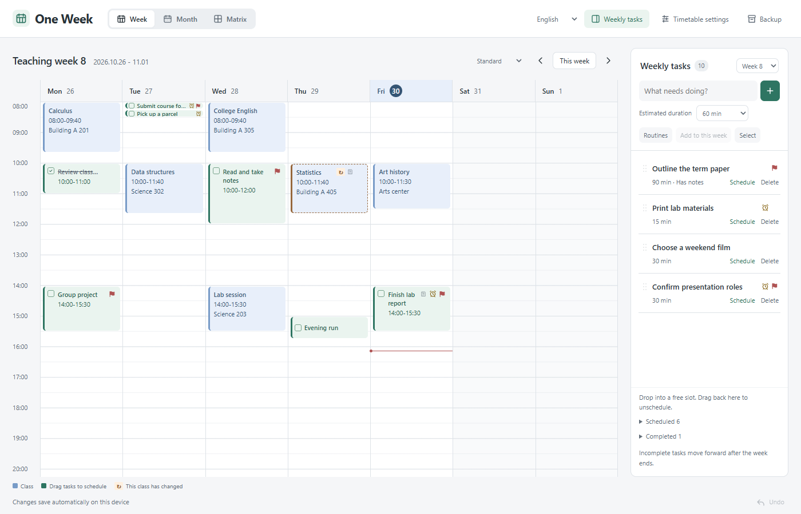

# One Week · 我的一周

把课表放好，把想做的事安排进空档。

面向大学生的 Obsidian 本地日程插件。课程按教学周重复，待办可以暂时不安排时间。周历、月历和四象限共用同一份事项数据。



## 从自己的学期开始

1. 启用插件，点击 Obsidian 左侧的日历图标打开。也可在命令面板搜索“One Week”。不会自动跳到首页或固定页签。
2. 点击“设置我的课表”，填写学期名称、第 1 教学周的周一、总周数和时间轴范围。
3. 逐门添加课程，或选择“批量导入”，从 Excel / 表格复制课程行，或选择 UTF-8 CSV / TSV 文件。先预览，再确认导入。
4. 在右侧记下本周待办，拖入空闲时段，或点击“安排时间”。点击事项即可在统一窗口编辑。

新安装是空白课表，不含作者的课程或任何个人日程。升级时继续使用已有的本地数据。

## 导入课程的表格格式

包含表头，列顺序如下；教室、教师可以留空或省略这两列。

```csv
课程名称,星期,开始时间,结束时间,周次,教室,教师
高等数学,周一,08:00,09:40,1-16,教学楼 201,
大学英语,周三,10:00,11:40,1-16(单),教学楼 305,
学术写作,周五,14:00,15:30,"3,5,8",研讨室,
```

时间用 24 小时制；星期支持周一至周日或 1–7。周次支持范围、逗号列表和单双周。CSV 中含逗号的单元格用双引号包裹。完整重复的课程会跳过；课程冲突、已有安排冲突或非法字段会阻止导入，原数据保留。一次最多 300 行、文件不超过 200 KB。

可以在弹窗中填入示例查看格式。当前不直接解析学校 PDF；不同学校的节次、单双周和版式差异需要先整理成上述表格。

## 日常使用

- **待办栏**：右上角“本周待办”按钮可显示或隐藏侧栏，收起后课表扩宽，并记住本设备的选择。
- **周历**：课程默认淡蓝，个人安排为绿。标准视图按当前页签高度显示前 12 小时（08:00 开始时可看到 20:00），晚间时段可继续向下滚动。短事项保留完成勾选，相邻的极短事项会错列显示，避免互相遮挡；“舒展”按窗口高度显示前 9 小时（08:00–17:00），切换显示模式会回到早间起点。拖动改时间、拖底部调整时长，双击空档添加安排。触摸设备可用“安排时间”表单。
- **月历**：查看整月，点日期查看当天；已安排事项拖到其它日期时保留钟点与时长。
- **四象限**：只展示所选教学周的个人事项，包括未安排时间的待办。重要用红旗、紧急用闹铃；紧急但不重要用淡黄。闹铃是优先级标志，不是定时通知。
- **临时调课**：点开某一次课程，在时间或教室旁“调整”。开始时间变化时按现有课时推算结束时间；手动改结束时间也支持。课程显示“调”字与虚线边框，可分别恢复原时间或原教室，其它周不变。
- **备注链接**：同一个备注区域切换编辑和可点击阅读，不重复列链接。支持网址、Markdown 链接和 Obsidian `[[笔记]]`。保存事项后才写入备注草稿。
- **顺延**：手动顺延到下一周待办，会清除已安排时间。按设备本地时区，进入新一周后自动将过去未完成事项移入本周待办；插件关闭时不运行，下次启用补做。课程和已完成事项不移动，学期结束后暂留最后一周。
- **常规日程**：把常用事项存为模板，每周一键加入；固定时段发生冲突会先放入待办。同一模板在同一周只加入一次，模板修改不改动已经生成的事项。
- **撤销**：底部按钮或在日程内按 Ctrl / ⌘ Z，可撤销本窗口最近 10 次数据修改。关闭页面或收到另一个窗口的更新后清空历史。输入框内仍使用文字编辑的撤销。

## 数据与隐私

所有课程、待办、备注和安排保存在本插件文件夹的 `data.json`。视图和显示密度仅保存在设备上的界面偏好中。插件不上传数据、不使用账户、不收集遥测；主动打开外部链接时由浏览器访问对应网站。

“备份”导出完整 JSON 到库内 `我的一周备份/`；浏览器预览则下载文件。导入备份需要确认，之后会替换当前数据，建议先导出当前版本。读取失败不会自动清空数据；写入成功后才显示保存成功。多窗口同时编辑会检查冲突并保留尚未保存的草稿。

这不是 Markdown 任务同步工具：它不自动修改每日笔记，也不与 Tasks / Dataview 双向同步。跨设备可以备份迁移；不要把两个设备同时修改同一个 JSON 当作已经支持的协同编辑。

## 安装与升级

下载公开版本：[GitHub Releases](https://github.com/yibai435-star/one-week/releases)。社区目录上架需审核通过；在此之前可手动安装。

1. 将发行包中的 `main.js`、`manifest.json`、`styles.css` 放入 `<vault>/.obsidian/plugins/baiyi-weekly-planner/`。
2. 在 Obsidian 的设置 → 社区插件中启用“One Week”。
3. 升级前导出备份；只替换以上三个文件，保留 `data.json`。关闭未保存的编辑窗口后，重新启用插件。

第一版面向桌面 Obsidian 1.14.5 及以上，支持深浅主题和窄页签布局。移动端暂未开放。右上角可切换中文与 English；课程名称、备注和日程数据保持原文。

## 从源码构建

Node.js 18 或以上。公开源码候选包含独立依赖锁定文件。

```sh
npm ci
npm test
npm run check
npm run build
```

构建结果位于 `dist/`。`index.html` 可用于独立浏览器预览，不读取 Obsidian 笔记库。公开源码包只包含通用配置和虚构测试数据；本地开发目录中单独保留的个人课表回归样例不应上传。

当前版本的发布检查见 [RELEASE.md](RELEASE.md)。按 MIT 许可证发布。
